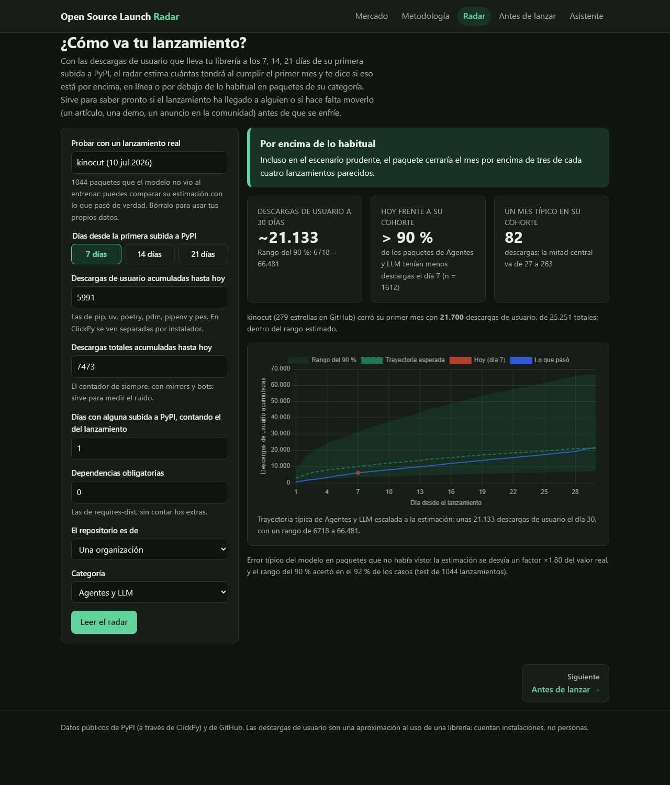
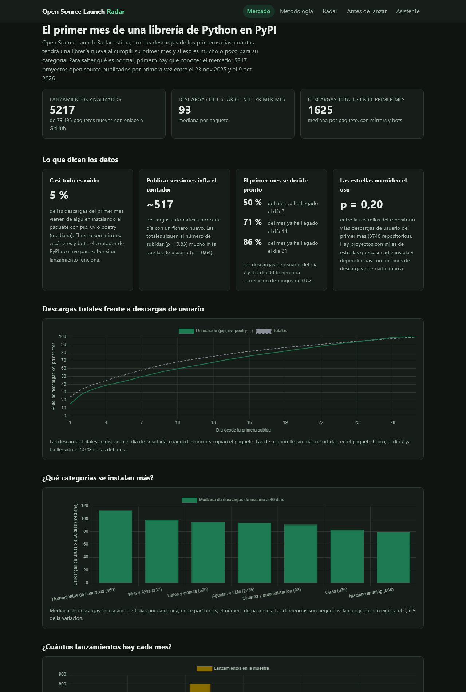
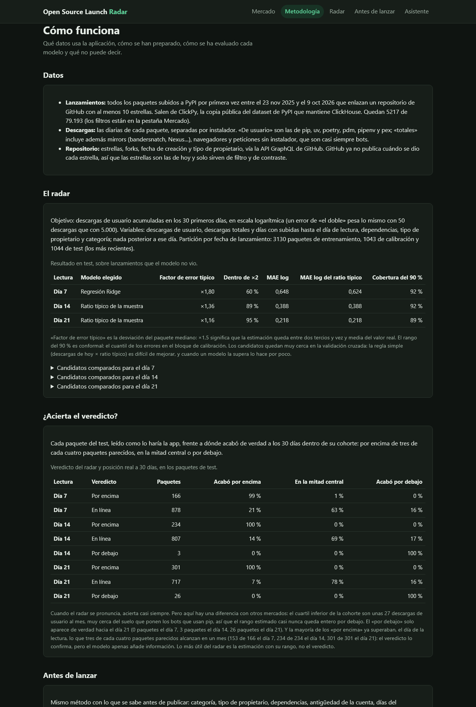
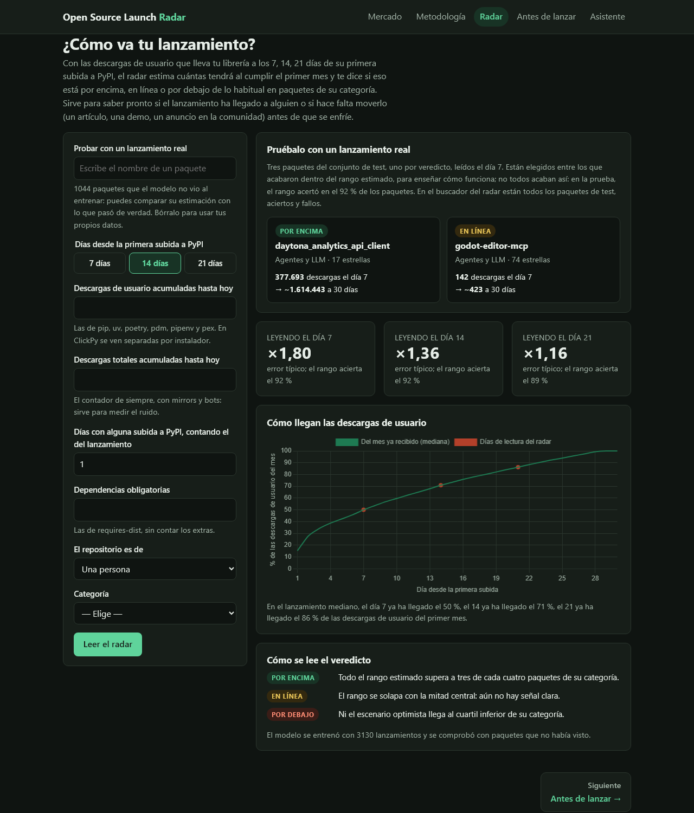
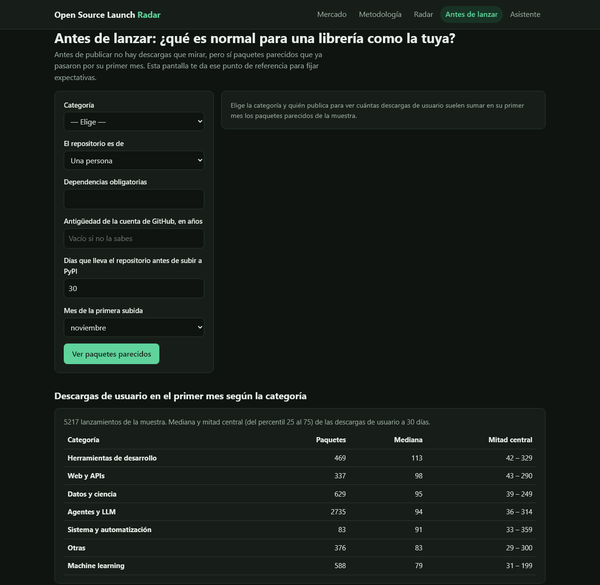
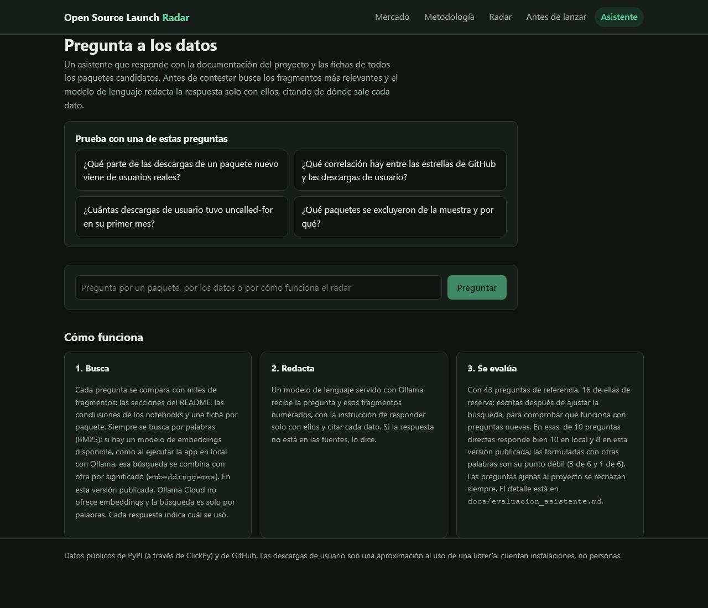
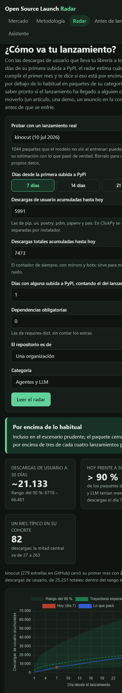
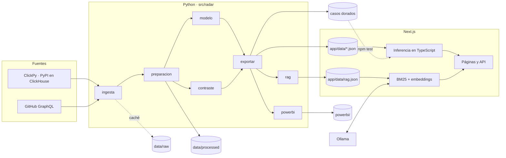

# Open Source Launch Radar

Estima con las descargas de los primeros días cuántas tendrá una librería de Python
nueva al cumplir su primer mes en PyPI y si eso es mucho o poco para su categoría.

Quien publica una librería open source pasa el primer mes a ciegas. PyPI enseña un
contador de descargas, pero un paquete recién subido recibe cientos de descargas de
mirrors y bots aunque no lo use nadie, así que el número no dice si el proyecto está
llegando a alguien. **Open Source Launch Radar** separa las descargas de usuario (las
de pip, uv o poetry) del ruido, toma las de los primeros 7, 14 o 21 días, estima
cuántas tendrá el paquete al cumplir 30 y dice si eso está por encima, en línea o por
debajo de lo habitual en su categoría. Antes de publicar, enseña el rango de paquetes
parecidos.

Lo completan un **asistente con RAG** que responde preguntas sobre los datos y el
modelo citando sus fuentes, y un **panel de Power BI** con los indicadores de la
muestra, el ruido de las descargas y la calidad del modelo.



**Resultados clave**, sobre 5.217 proyectos open source publicados por primera vez en
PyPI entre noviembre de 2025 y octubre de 2026:

- **El contador de PyPI es casi todo ruido:** en el paquete mediano, solo el **5 %** de
  las descargas de su primer mes vienen de alguien instalándolo. Cada día con un fichero
  nuevo trae unas **520 descargas automáticas** de mirrors y bots.
- **Las estrellas no miden el uso:** la correlación de rangos entre las estrellas de
  GitHub y las descargas de usuario es de **0,20**. Hay proyectos con decenas de miles de
  estrellas que casi nadie instala y dependencias con millones de descargas y 17
  estrellas.
- **La estimación del día 7 se desvía un ×1,80** en el paquete típico (×1,36 el día 14
  y ×1,16 el día 21), y su rango del 90 % acierta en el 92 % de los paquetes que el
  modelo no vio.
- **La regla simple vuelve a ser difícil de batir:** «descargas de hoy × multiplicador
  típico» gana a Ridge y a gradient boosting en los días 14 y 21, y empata a día 7.
- **Antes de publicar casi no hay señal:** la categoría o quién publica explican menos
  del 1 % de las diferencias; la app enseña un rango en lugar de inventar una cifra.

---

## 1. Problema y usuario

El usuario es quien mantiene una librería open source recién publicada, o el equipo de
DevRel de una empresa que acaba de sacar su SDK. En las primeras semanas tiene que
decidir si escribe un artículo, prepara una demo, la presenta en una comunidad o pasa
a otra cosa, y solo tiene un número engañoso: el contador de descargas de PyPI, que con
una sola versión ya marca unas 500 aunque no la haya instalado nadie. Con el radar
introduce sus descargas de usuario y totales (más los días con subidas, las
dependencias, quién publica y la categoría) y obtiene:

- una estimación de las descargas de usuario a 30 días con un rango del 90 %,
- dónde queda frente a los lanzamientos de su categoría,
- un veredicto que solo se pronuncia cuando todo el rango queda por encima o por
  debajo de lo normal.

Hoy no tiene con qué compararse: pepy.tech o pypistats enseñan la serie de un paquete,
pero no cómo suele evolucionar un lanzamiento parecido, ni cuánto de esa serie es ruido.

## 2. Datos

| Fuente                                                                                                    | Qué aporta                                                                       | Acceso                                                                     |
| --------------------------------------------------------------------------------------------------------- | -------------------------------------------------------------------------------- | -------------------------------------------------------------------------- |
| [ClickPy](https://clickpy.clickhouse.com): tabla `projects`                                               | Cada fichero subido a PyPI: nombre, versión, fecha, resumen, URLs, dependencias | Sin clave (usuario `demo` de ClickHouse); 20 consultas iguales por hora    |
| ClickPy: `pypi_downloads_per_day_by_version_by_installer_by_type`                                         | Descargas diarias de cada paquete, separadas por instalador                      | Igual; como mucho 10.000 filas por resultado                               |
| [API GraphQL de GitHub](https://docs.github.com/graphql)                                                  | Estrellas, forks, fecha de creación, temas y tipo de propietario del repositorio | Token de GitHub (el de `gh` en local, el `GITHUB_TOKEN` del workflow en CI) |

ClickPy es la copia que mantiene ClickHouse de los mismos datos que PyPI publica en
BigQuery, actualizada a diario. La ingesta pregunta por meses y recibe las series
diarias como un array por paquete, para caber en los límites del usuario demo, y espera
a que se renueve el cupo cuando se agota.

- **Muestra:** los paquetes publicados por primera vez en PyPI entre el 23-11-2025 y el
  09-10-2026 que enlazan un repositorio de GitHub con al menos 10 estrellas. Descarga del
  23-11-2026. De 79.193 paquetes nuevos con enlace a GitHub quedan 5.217 aptos (los
  filtros, en el apartado 3).
- **Por qué descargas y no estrellas.** La idea inicial era predecir las estrellas de un
  repositorio a partir de las de sus primeros días. Al construir la ingesta comprobé que
  en 2026 GitHub ya no publica quién da cada estrella ni cuándo: el listado de
  stargazers responde 404 incluso con sesión, y GH Archive dejó de recibir esos eventos
  (de unos 6 millones al mes en 2024 a menos de 100.000 en el verano de 2026). Sin serie
  temporal no hay radar, así que la señal pasó a ser la de PyPI y las estrellas, que sí
  se pueden leer hoy, quedaron como contraste.
- **Por qué descargas de usuario y no totales.** El contador público suma las descargas
  de mirrors (bandersnatch, Nexus…), navegadores y peticiones sin instalador, que son
  casi siempre bots. Las de pip, uv, poetry, pdm, pipenv y pex son las de alguien (una
  persona o un proyecto con CI) instalando el paquete. Es una aproximación al uso, no
  un recuento de personas.
- **Privacidad:** de cada repositorio solo se guardan cifras agregadas y públicas
  (estrellas, forks, fechas) y el nombre del propietario. Ni ClickPy ni la ingesta
  tocan datos de quien descarga.
- **Obtención:** `python -m radar.ingesta` descarga todo (una hora y media, sobre todo por
  el cupo de ClickPy; se puede cortar y reanudar). Las tablas procesadas ya vienen en el
  repositorio, así que no hace falta para usar la app.

Diccionario de las tablas de `data/processed/`:

| Tabla                   | Filas                                         | Columnas principales                                                                                                                                       |
| ----------------------- | --------------------------------------------- | ---------------------------------------------------------------------------------------------------------------------------------------------------------- |
| `paquetes.csv`          | 10.610 candidatos                             | `paquete`, `repo`, `fecha_lanzamiento`, `categoria`, `estrellas`, `usuario_{7,14,21,30}d`, `total_{…}d`, `subidas_{…}d`, `estado` (apto o motivo de exclusión) |
| `descargas_diarias.csv` | una por paquete apto y día con descargas      | `paquete`, `dia` (0 = primera subida), `usuario`, `total`                                                                                                  |
| `dataset_radar.csv`     | 5.217                                         | variables previas al lanzamiento, lecturas de los días 7, 14 y 21 y el objetivo `usuario_30d`                                                             |
| `embudo.json`           | —                                             | paquetes que quedan tras cada filtro                                                                                                                       |

## 3. Preprocesamiento y EDA

[`notebooks/01_preproceso.ipynb`](notebooks/01_preproceso.ipynb) recorre la limpieza
con los datos reales; la lógica vive en `src/radar/preparacion.py`.

- Cada descarga se sitúa en su día relativo a la primera subida a PyPI (día 0), en UTC.
- Los filtros, en orden: repositorio que exista (61.817), con 10 estrellas o más
  (10.610), que no sea una copia de un proyecto ajeno (385 fuera), que no sea un fork
  (78), sin versiones anteriores borradas de PyPI (481: más del 5 % del primer mes
  descargado antes del día 0) y con un repositorio de menos de un año cuando sube a PyPI
  (4.449 fuera: eran proyectos que ya tenían usuarios). Quedan 5.217.
- **Republicadores.** En 2026 hay cuentas que suben a PyPI cientos de servidores MCP
  ajenos con un prefijo propio (`iflow-mcp-…`, `mseep-…`) y enlazan el repositorio
  original, quedándose con sus estrellas. La regla no es una lista escrita a mano: un
  prefijo cuenta si se usa con repositorios de al menos 10 dueños distintos y si la
  mayoría de sus paquetes siguen ese patrón. La segunda condición evita excluir los
  ecosistemas de plugins (`langchain-…`, `django-…`, `pytest-…`), donde el patrón no pasa
  del 20 %.
- El volumen es muy asimétrico (mediana de 93 descargas de usuario a 30 días, media de
  unas 17.000): se trabaja en log(1 + descargas). Los paquetes más grandes son
  dependencias reales que otro paquete arrastra y no se recortan.

[`notebooks/02_eda.ipynb`](notebooks/02_eda.ipynb) responde siete preguntas. Las que
deciden el producto:

- **Casi todo es ruido:** en el paquete mediano, el 5 % de las descargas del primer mes
  son de usuario; en uno de cada diez, menos del 2 %.
- **Publicar versiones infla el contador:** unas 520 descargas automáticas por cada día
  con un fichero nuevo. Las totales siguen al número de subidas (ρ = 0,83) mucho más que
  las de usuario (ρ = 0,64).
- **El mes se decide pronto, pero no tanto como en otros mercados:** el día 7 ha llegado
  la mitad de las descargas de usuario del mes, el día 14 el 71 % y el día 21 el 86 %.
  Los tres primeros días son ruido de la subida, por eso la primera lectura es el día 7.
- **La relación es casi lineal en log** (ρ de Spearman de 0,82 entre el día 7 y el 30,
  0,97 entre el 21 y el 30): la regla «descargas de hoy × multiplicador típico» es un
  baseline exigente.
- **Antes de lanzar, la categoría y quién publica explican muy poco** (ε² de 0,005 y
  0,004): sirven para situar un rango, no para dar una cifra.
- **Las estrellas no son uso:** ρ = 0,20 entre estrellas y descargas de usuario.
- **Sesgo de selección:** exigir 10 estrellas el día de la descarga favorece a los
  proyectos con más tiempo para conseguirlas; los últimos meses tienen menos
  lanzamientos (807 en marzo, 254 en septiembre).

## 4. Ciencia de datos

[`notebooks/03_modelo.ipynb`](notebooks/03_modelo.ipynb) y `src/radar/modelo.py`.

- **Objetivo:** log(1 + descargas de usuario a 30 días).
- **Variables del radar:** descargas de usuario y totales y días con subidas hasta el
  día de lectura, dependencias, tipo de propietario y categoría. Nada posterior a ese
  día; las estrellas tampoco, porque son las de hoy.
- **Partición por fecha de lanzamiento:** 3.130 paquetes de entrenamiento, 1.043 de
  calibración y 1.044 de test (los más recientes, de julio a octubre de 2026).
- **Candidatos:** la mediana, el ratio típico de la muestra (la regla de la hoja de
  cálculo), Ridge y gradient boosting. Se elige por validación cruzada temporal dentro
  del entrenamiento; el test se usa una sola vez.
- **Intervalo del 90 %:** conformal, con el cuantil de los errores en el bloque de
  calibración.

Resultado en test, sobre lanzamientos que el modelo no vio:

| Lectura         | Modelo elegido    | Factor de error típico    | Dentro de ×2 | Cobertura del rango del 90 % |
| --------------- | ----------------- | ------------------------- | ------------ | ---------------------------- |
| Día 7           | Ridge             | ×1,80 (el ratio: ×1,70)   | 60 %         | 92 %                         |
| Día 14          | Ratio típico      | ×1,36                     | 89 %         | 92 %                         |
| Día 21          | Ratio típico      | ×1,16                     | 95 %         | 89 %                         |
| Antes de lanzar | Gradient boosting | ×2,49 (la mediana: ×2,65) | 40 %         | 88 %                         |

«Factor de error típico» es la desviación en el paquete mediano: ×1,36 significa que la
estimación queda entre un 26 % por debajo y un 36 % por encima del valor real.

- **La regla simple gana o empata.** A días 14 y 21 el ratio típico es el mejor en la
  validación cruzada y en test. A día 7 Ridge lo supera por poco en la validación
  cruzada (MAE de 0,667 frente a 0,684, dentro del ruido entre pliegues) y en test
  queda algo por detrás. Se respeta lo que dice la validación, pero la conclusión es la
  misma: más complejidad apenas añade nada.
- **Antes de lanzar casi no hay señal.** El modelo elegido mejora a la mediana por poco;
  la app enseña su cifra junto al rango de paquetes parecidos, que es lo que de verdad
  se puede decir.
- **Deriva temporal.** En el periodo de test el modelo sobreestima en torno a un 30 %:
  el multiplicador del día 7 al 30 era de ×2,0 a ×2,5 en los meses de entrenamiento y de
  ×1,6 a ×2,1 en los de test. El rango conformal lo absorbe en buena parte, y es lo
  primero que se revisa en cada reentrenamiento mensual.

### ¿Acierta el veredicto?

`aciertos_veredicto` (`src/radar/exportar.py`) lee cada paquete del test como lo haría
la app y lo compara con dónde acabó de verdad a 30 días dentro de su cohorte:

| Lectura | Veredicto  | Paquetes | Acabó por encima | En la mitad central | Acabó por debajo |
| ------- | ---------- | -------- | ---------------- | ------------------- | ---------------- |
| Día 7   | Por encima | 166      | 99 %             | 1 %                 | 0 %              |
| Día 7   | En línea   | 878      | 21 %             | 63 %                | 16 %             |
| Día 14  | Por encima | 234      | 100 %            | 0 %                 | 0 %              |
| Día 14  | En línea   | 807      | 14 %             | 69 %                | 17 %             |
| Día 14  | Por debajo | 3        | 0 %              | 0 %                 | 100 %            |
| Día 21  | Por encima | 301      | 100 %            | 0 %                 | 0 %              |
| Día 21  | En línea   | 717      | 7 %              | 78 %                | 16 %             |
| Día 21  | Por debajo | 26       | 0 %              | 0 %                 | 100 %            |

- **Cuando se pronuncia, acierta**, pero se pronuncia poco. El «por debajo» casi no
  aparece antes del día 21: el cuartil inferior de la cohorte son unas 27 descargas de
  usuario al mes, pegado al suelo que ponen los bots que también usan pip, así que el
  rango estimado casi nunca queda entero por debajo. Es una diferencia real con
  mercados como Steam, donde un mal mes se ve en la primera semana.
- **Los «por encima» son casi siempre triviales:** el paquete ya tenía, el día de la
  lectura, más descargas que tres de cada cuatro paquetes parecidos en un mes (153 de
  166 el día 7). Lo útil del radar es la estimación con su rango, más que el veredicto.

### Contraste con las estrellas de GitHub

`src/radar/contraste.py` cruza las descargas de usuario del primer mes con las
estrellas de hoy del repositorio, con un paquete por repositorio (los monorepos
comparten estrellas):

- **Correlación de rangos de 0,20** entre 3.748 repositorios. El paquete mediano suma
  3,3 descargas de usuario por estrella, pero la mitad central va de 1,2 a 9,1.
- **Muchas estrellas, casi ningún uso:** aplicaciones y demos como
  `usestrix/strix` (77.000 estrellas, 3 descargas de usuario de su paquete
  `strix-sandbox` en el primer mes) o `andrewyng/openworker` (19.500 estrellas, 26
  descargas).
- **Mucho uso, casi ninguna estrella:** dependencias que otro paquete arrastra, como
  `uncalled-for` (48,8 millones de descargas de usuario en su primer mes, 17 estrellas).
- **Conclusión:** miden cosas distintas. Las estrellas son atención; las descargas de
  usuario, uso. Un proyecto que solo mire una de las dos no sabe cómo va, y por eso el
  radar predice uso y enseña las estrellas como contexto.

### Asistente (RAG)

`src/radar/rag.py` construye el índice y `app/src/lib/rag.ts` hace la recuperación.

- **Corpus:** el README y las celdas de texto de los notebooks, cortados por secciones,
  y una ficha por paquete candidato con sus cifras (descargas en cada lectura,
  estrellas, categoría y por qué se excluyó si es el caso).
- **Recuperación:** BM25 sobre las palabras y similitud de coseno sobre embeddings de
  `embeddinggemma` (Ollama), combinados con Reciprocal Rank Fusion. Los vectores se
  guardan normalizados y cuantizados a int8, sin base de datos vectorial. Entre los
  seis fragmentos que recibe el modelo entran como mucho dos fichas, para que no
  desplacen a la documentación.
- **Generación:** un modelo servido con Ollama (`qwen3.5` en local) recibe esos
  fragmentos con la instrucción de responder solo con ellos y citar cada dato con su
  número.
- **Evaluación** (`npm run evaluar-asistente`, detalle en
  [`docs/evaluacion_asistente.md`](docs/evaluacion_asistente.md)): 43 preguntas de
  referencia, cada una con las secciones que contienen la respuesta. 24 son de
  **ajuste** y 16 de **reserva**, escritas aparte para comprobar que lo decidido
  generaliza; en los dos grupos hay preguntas directas y **reformuladas** sin las
  palabras de la documentación («¿cuánto tráfico de bots recibe una librería solo por
  publicar una versión nueva?»). Otras 3 son ajenas al proyecto.

| Respuestas con el dato esperado | Ajuste: directas | Ajuste: reformuladas | Reserva: directas | Reserva: reformuladas |
| ------------------------------- | ---------------- | -------------------- | ----------------- | --------------------- |
| Híbrida (local)                 | 18/19            | 4/5                  | 8/10              | 3/6                   |
| Solo palabras                   | 18/19            | 2/5                  | 7/10              | 4/6                   |

En los dos modos todas las respuestas citan su fuente, las 3 preguntas ajenas se
rechazan y cada respuesta tarda menos de 2 segundos. Los grupos son pequeños y el
modelo varía entre ejecuciones, así que diferencias de una pregunta no son
significativas; la comprobación busca la cifra o el término esperado, y el informe
guarda cada respuesta para revisarlas a mano.

## 5. La aplicación

| Sección              | Qué hace                                                                                                                                                                                                       |
| -------------------- | -------------------------------------------------------------------------------------------------------------------------------------------------------------------------------------------------------------- |
| **Mercado** (`/`)    | La portada. Los hallazgos del EDA, las descargas totales frente a las de usuario, las categorías, los lanzamientos por mes, el contraste con las estrellas y el embudo de filtros.                         |
| **Metodología**      | Datos, comparación de candidatos, métricas de test, acierto del veredicto, contraste con las estrellas y limitaciones, leídos de los mismos JSON que usa el modelo.                                         |
| **Radar** (`/radar`) | Estimación a 30 días, comparación con la cohorte, veredicto y trayectoria esperada. Se puede probar con los 1.044 paquetes del test y ver lo que pasó después. Admite enlaces del tipo `/radar?paquete=…&dia=7`. |
| **Antes de lanzar**  | Descargas de usuario a 30 días de paquetes de la misma categoría y tipo de propietario (mediana y mitad central).                                                                                            |
| **Asistente**        | Chat con RAG: responde con la documentación y las fichas de los paquetes, cita cada dato y enseña las fuentes recuperadas aunque el modelo de lenguaje no responda.                                         |

API del servidor:

| Ruta                          | Respuesta                                                                                                                                                                       |
| ----------------------------- | ------------------------------------------------------------------------------------------------------------------------------------------------------------------------------- |
| `POST /api/radar`             | Lectura del radar. Cuerpo: `dia` (7, 14 o 21), `usuario`, `total`, `subidas`, `dependencias` (enteros), `propietario_tipo` (`Persona` u `Organización`) y `categoria`.         |
| `POST /api/previo`            | Referencia antes de lanzar. Cuerpo: `categoria`, `propietario_tipo`, `dependencias`, `anios_cuenta` (opcional), `dias_repo_previos` y `mes_lanzamiento` (1-12).                |
| `GET /api/ejemplos/{paquete}` | Ficha y descargas diarias reales de un lanzamiento del test (nombre normalizado de PyPI).                                                                                      |
| `POST /api/asistente`         | Respuesta del asistente en NDJSON: una línea con las fuentes, los trozos de texto según se generan y una de cierre o error. Como mucho 20 preguntas por IP cada 10 minutos (429). |

Las entradas se validan en el formulario y otra vez en el servidor, con mensajes que
nombran el campo erróneo (400): por ejemplo, las descargas totales no pueden ser menos
que las de usuario. Si faltan los datos exportados, las páginas y la API lo dicen (503).

### Panel de inteligencia (Power BI)

[`powerbi/OpenSourceLaunchRadar.pbip`](powerbi/) es un proyecto de Power BI en formato
de texto (modelo semántico en TMDL e informe en PBIR), generado desde Python con
`python -m radar.powerbi --proyecto`. Cada mes, `python -m radar.powerbi` solo renueva
sus CSV. Cada página responde a una pregunta:

| Página                     | Pregunta                                         | Contenido                                                                       |
| -------------------------- | ------------------------------------------------ | ------------------------------------------------------------------------------- |
| **Mercado**                | ¿Cómo es un lanzamiento típico en PyPI?          | Lanzamientos, mediana de descargas y de estrellas, por mes, categoría y estado  |
| **Ruido de las descargas** | ¿Cuánto del contador es uso real?                | % de usuario, descargas totales y la curva del mes de usuario frente a totales |
| **Calidad del modelo**     | ¿Cuánto acierta el radar en paquetes que no vio? | Factor de error, cobertura del rango, estimación frente a realidad, candidatos  |
| **Detalle por paquete**    | ¿Qué estimó para cada paquete del test?          | Tabla con la lectura, el rango y el valor real                                  |

El modelo es una estrella: `paquetes`, `calendario` y `lecturas` como dimensiones, y
`curva_diaria`, `predicciones` y `metricas` como hechos. Las consultas leen los CSV de
`powerbi/datos/` desde GitHub, así que el panel se actualiza con «Actualizar»; el
parámetro `OrigenDatos` admite también una carpeta local. Un test comprueba que el
factor de error y la cobertura del panel coinciden con los de la app. Para abrirlo hace
falta [Power BI Desktop](https://aka.ms/pbidesktopstore) (gratuito, Windows): abrir el
`.pbip` y pulsar **Inicio → Actualizar**.

| Mercado                                               | Metodología                                   | Radar antes de la primera lectura                                    |
| ----------------------------------------------------- | --------------------------------------------- | -------------------------------------------------------------------- |
|                  |  |                       |
| **Antes de lanzar**                                   | **Asistente**                                 | **Móvil**                                                            |
|  |      |  |

## 6. Arquitectura y stack



- **Ingesta:** `requests` con reintentos y espera hasta que se renueva el cupo de cada
  fuente (el QUOTA_EXCEEDED de ClickHouse indica cuándo; GitHub, en sus cabeceras).
  Cada paso guarda en `data/raw/` de forma atómica, así que una descarga cortada se
  reanuda donde se quedó.
- **Datos y modelo:** pandas y scikit-learn (Ridge, gradient boosting,
  `TimeSeriesSplit`), con el intervalo conformal escrito a mano.
- **Aplicación:** Next.js 16 (App Router), React 19, TypeScript y Chart.js. No hay base
  de datos ni Python en producción: los modelos viajan como JSON y se evalúan en el
  servidor de Next.
- **Asistente:** Ollama para los embeddings (`embeddinggemma`) y la generación. BM25, el
  coseno y la fusión están escritos en TypeScript, sin dependencias.
- **Calidad:** ruff, pytest con cobertura mínima del 90 %, ESLint, Prettier,
  `tsc --noEmit`, tests de Node y una prueba de humo contra el build de producción.
  Gitleaks revisa todo el historial en busca de secretos.
- **Automatización:** `ci.yml` ejecuta todas las comprobaciones en cada push y Pull
  Request. `actualizar-datos.yml` se lanza el día 1 de cada mes (o a mano): descarga los
  lanzamientos nuevos, reentrena, reejecuta los notebooks y los tests, y abre un Pull
  Request con los datos y un resumen de las métricas para revisarlo antes de publicar.

## 7. Instalación y ejecución

Requisitos: Python 3.13 y Node.js 22.18 o superior (los tests ejecutan TypeScript
directamente, algo que Node admite desde esa versión).

```bash
git clone https://github.com/alvarodc093-pixel/open-source-launch-radar.git
cd open-source-launch-radar
```

**Solo la aplicación** (los datos y modelos ya vienen en el repositorio):

```bash
cd app
npm ci
npm run dev                       # http://localhost:3000
```

**Entorno de Python** (para regenerar datos, notebooks o modelos y pasar sus tests):

```bash
python -m venv .venv
source .venv/bin/activate         # Windows: .venv\Scripts\activate
pip install -r requirements.txt
```

Rehacer todo desde cero:

```bash
python -m radar.ingesta           # ClickPy y GitHub (hora y media, reanudable)
python -m radar.preparacion       # data/processed/
python -m radar.exportar          # app/data/*.json y casos dorados de la app
python -m radar.rag               # app/data/rag.json (índice del asistente; necesita Ollama)
python -m radar.powerbi           # powerbi/datos/*.csv (--proyecto: también el .pbip)
python -m radar.informe           # resumen de métricas en Markdown
```

La ingesta de GitHub necesita un token: si `GITHUB_TOKEN` está vacío, usa el de la
sesión de la CLI `gh`. Ver `.env.example`.

**Asistente en local.** Con [Ollama](https://ollama.com) instalado y abierto:

```bash
ollama pull embeddinggemma        # embeddings de las preguntas
ollama pull qwen3.5               # modelo que redacta las respuestas
cd app && npm run dev             # http://localhost:3000/asistente
npm run evaluar-asistente         # vuelve a medir la calidad (unos minutos)
```

Sin Ollama la app funciona igual y el asistente explica que no puede responder,
enseñando las fuentes que encontró.

### Despliegue en Vercel

En Vercel, «Add New Project», importar el repositorio y fijar **Root Directory =
`app`**. El radar no necesita variables de entorno. El asistente sí, porque Vercel no
llega al Ollama de un equipo local: `OLLAMA_HOST=https://ollama.com`, `OLLAMA_API_KEY`
con una clave de [ollama.com/settings/keys](https://ollama.com/settings/keys) y
`OLLAMA_MODELO` con un modelo de la nube (por ejemplo `gpt-oss:120b`).

### Actualización mensual de los datos

El workflow necesita permiso para abrir Pull Requests: en GitHub, _Settings → Actions →
General → Workflow permissions_, marcar «Read and write permissions» y «Allow GitHub
Actions to create and approve pull requests».

### Comprobaciones

| Dónde  | Comando                                                     | Qué cubre                                                                                 |
| ------ | ----------------------------------------------------------- | ----------------------------------------------------------------------------------------- |
| Raíz   | `ruff check . && ruff format --check .`                     | Estilo y errores en `src/`, `tests/` y notebooks                                          |
| Raíz   | `pytest --cov`                                              | 108 tests de ingesta, preparación, modelo, exportación, EDA, contraste, asistente y panel (cobertura del 98 %) |
| `app/` | `npm run lint && npm run format:check && npm run typecheck` | ESLint, Prettier y tipos                                                                  |
| `app/` | `npm test`                                                  | Inferencia en TypeScript frente a 4.176 casos calculados en Python, y recuperación y validación del asistente |
| `app/` | `npm run evaluar-asistente`                                 | Calidad del asistente con Ollama (recuperación y respuestas) |
| `app/` | `npm run build && npm run humo`                             | Arranca el build de producción y prueba páginas y API                                     |

## 8. Estructura del repositorio

```
open-source-launch-radar/
├── .github/workflows/
│   ├── ci.yml                    lint, tests, build, humo y gitleaks
│   └── actualizar-datos.yml      reentrenamiento mensual con Pull Request
├── data/
│   ├── raw/                      caché de la ingesta (no se versiona)
│   └── processed/                paquetes, descargas diarias, dataset y embudo
├── notebooks/                    01_preproceso · 02_eda · 03_modelo
├── src/radar/
│   ├── config.py                 rutas, ventana de lanzamientos y umbrales
│   ├── ingesta/                  ClickPy, GitHub GraphQL y cliente HTTP con cupos
│   ├── preparacion.py            limpieza, exclusiones, republicadores y variables
│   ├── eda.py                    cifras del EDA que también enseña la app
│   ├── contraste.py              descargas de usuario frente a estrellas
│   ├── modelo.py                 partición temporal, candidatos e intervalo conformal
│   ├── exportar.py               modelos y tablas para la app
│   ├── rag.py                    índice del asistente (fragmentos y embeddings)
│   ├── powerbi.py                tablas en estrella y proyecto de Power BI
│   └── informe.py                resumen de métricas
├── tests/                        pytest
├── powerbi/
│   ├── datos/                    CSV del modelo en estrella
│   ├── OpenSourceLaunchRadar.pbip             se abre con Power BI Desktop
│   ├── OpenSourceLaunchRadar.SemanticModel/   tablas, relaciones y medidas DAX (TMDL)
│   └── OpenSourceLaunchRadar.Report/          páginas y visuales (PBIR)
├── app/
│   ├── data/                     modelos, tablas e índice del asistente
│   ├── src/app/                  páginas y rutas de la API
│   ├── src/components/           formularios y gráficos
│   ├── src/lib/                  inferencia, validación y lectura de datos
│   ├── tests/                    casos dorados, preguntas de referencia y tests de Node
│   └── scripts/                  prueba de humo y evaluación del asistente
├── docs/
│   ├── capturas/
│   └── evaluacion_asistente.md   resultado de la última evaluación del asistente
├── requirements.txt              versiones exactas; instala también el paquete radar
├── pyproject.toml                ruff, pytest y cobertura
└── LICENSE
```

## 9. Decisiones técnicas y aprendizajes

- **Probar las fuentes antes de diseñar.** El proyecto empezó como un radar de
  estrellas de GitHub. Antes de escribir la ingesta comprobé que GitHub ya no publica
  las fechas de las estrellas y que GH Archive había perdido esos eventos; cambiar a
  PyPI en ese momento costó una tarde, descubrirlo con el proyecto hecho habría costado
  el proyecto.
- **Mirar qué mide el contador antes de predecirlo.** Predecir las descargas totales
  habría sido predecir cuántas versiones publica cada proyecto. Separar las de usuario
  fue la decisión que más cambia el resultado, y salió de mirar una serie diaria a mano.
- **Los límites de la fuente definen la ingesta.** ClickPy permite 20 ejecuciones de la
  misma consulta por hora y 10.000 filas por resultado. Preguntar por meses y recibir
  cada serie como un array por paquete bajó la ingesta de unas 170 consultas a unas 15.
  Y una consulta que funciona con `IN (...)` devolvía solo parte de los datos con un
  `JOIN`: se nota solo si se cuentan las filas.
- **Las reglas de limpieza también se validan.** La primera regla de republicadores
  excluía integraciones legítimas (`langchain-…`). Medir qué fracción de los paquetes de
  cada prefijo sigue el patrón separó los dos casos sin listas escritas a mano.
- **El baseline primero.** El ratio típico se implementó antes que cualquier modelo y
  sigue siendo el elegido en dos de las tres lecturas.
- **No dar una cifra cuando no hay señal.** Antes del lanzamiento la mejora sobre la
  mediana es mínima, y la app la enseña siempre al lado del rango de paquetes parecidos.
- **Inferencia en TypeScript con casos dorados.** Exportar coeficientes y árboles a JSON
  evita un servicio de Python en producción; los casos que Python calcula y la app
  tiene que reproducir (diferencia menor de 0,0001 en log) cubren el riesgo de que las
  dos implementaciones diverjan.

## 10. Qué mejoraría con más tiempo

- **Separar la integración continua de las personas:** las descargas desde GitHub
  Actions u otros CI aparecen como pip o uv. ClickPy tiene el detalle por sistema, que
  permitiría aproximarlo.
- **Una muestra sin sesgo de selección:** guardar cada mes las estrellas de todos los
  lanzamientos y fijar la entrada por las del día 30, algo que la actualización mensual
  ya permite acumular.
- **Estrellas con fecha propias:** guardar a diario el recuento de estrellas de los
  repositorios de la muestra para recuperar, desde ahora, la serie que GitHub ya no da.
- **Buscar el paquete por nombre en la app,** consultando ClickPy en directo, en lugar
  de pedir las cifras a mano.

## Convención de commits

Los commits siguen [Conventional Commits](https://www.conventionalcommits.org/es/):
`tipo(ámbito): descripción`, con los tipos `feat`, `fix`, `refactor`, `test`, `docs`,
`ci`, `data` y `chore`, y ámbitos como `ingesta`, `preparacion`, `modelo`, `app` o
`notebooks`.

## English summary

Open Source Launch Radar estimates how many user downloads (pip, uv, poetry…) a new
Python library will have after its first month on PyPI, using its downloads from the
first 7, 14 or 21 days, and says whether that is above, in line with or below what is
normal for its category. It is built on 5,217 open source projects first published on
PyPI between November 2025 and October 2026, with time-based validation. Two findings
shape the product: only 5 % of a typical new package's downloads come from users (the
rest are mirrors and bots), and GitHub stars barely track usage (Spearman ρ = 0.20). On
the 1,044 most recent launches, which the model never saw, the day-14 estimate is off by
a factor of ×1.36 for the typical package (×1.80 on day 7, ×1.16 on day 21) and its 90 %
range covers 92 % of packages. The project includes a Next.js web app, a RAG assistant
that cites its sources, a Power BI report and an automated monthly data refresh, with
tests and CI for both Python and the app.

## Licencia

Código bajo licencia [MIT](LICENSE). Los datos proceden de PyPI (vía ClickPy) y de
GitHub, y están sujetos a sus condiciones de uso.
